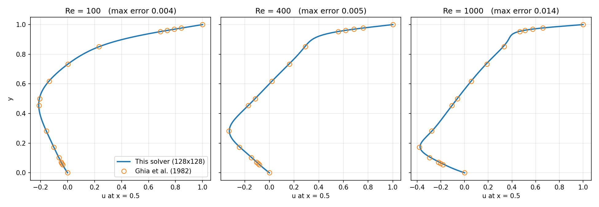

# Data-Driven Surrogates for Fluid Flows
[](https://github.com/ashokballamech-collab/flow-surrogates/actions/workflows/tests.yml)

Navier–Stokes solvers written from scratch in Python, validated against published
benchmarks, and used to build reduced-order and neural-network surrogate models —
including an inverse problem that recovers flow conditions from sparse sensors.

Everything here is built from first principles: no CFD package is used anywhere in
`src/`, and every model is benchmarked against either a published reference or a
simpler baseline.

---

## Results at a glance

| | Result | Reference |
|---|---|---|
| **Cavity solver** | centreline velocity within **0.014** of Ghia et al. at Re = 1000 | Ghia, Ghia & Shin (1982) |
| **Cylinder solver** | Strouhal number within **2.5–5.6%** over Re = 60–180 | Roshko (1954) |
| **Cavity surrogate** | **0.1–0.2%** error on unseen Re, ~**10⁵×** faster than the solver | vs. linear interpolation |
| **POD of the wake** | **10 modes** hold **99.99%** of the fluctuation energy | — |
| **DMD of the wake** | shedding frequency + 4 harmonics recovered from snapshots alone; **~3%** forecast error | vs. the solver |
| **POD surrogate** | full wake in **0.21 ms**, **1.8–3.1%** error at Reynolds numbers never trained on | vs. POD truncation limit |
| **Inverse problem** | Re recovered to **0.5–3.9%** from 4–20 noisy sensors | — |



*Centreline velocity from this solver (lines) against the benchmark of Ghia et al.
(circles) at Re = 100, 400 and 1000.*

---

## What is in here

### 1. Lid-driven cavity — `src/cavity_solver.py`

A 2D incompressible Navier–Stokes solver in the stream function–vorticity
formulation: second-order central differences, explicit time marching to steady
state, Thom's formula for wall vorticity, and a sparse LU factorization of the
Poisson matrix computed once and reused every step (which is what makes it fast
enough to be useful: solving from scratch each step would take ~37 hours instead
of ~47 seconds at Re = 1000).

Validated against Ghia et al. (1982) in both the centreline velocity profile and
the vortex strength and position.

### 2. Flow past a cylinder — `src/cylinder_solver.py`

A projection (fractional-step) method on a staggered MAC grid, with the cylinder
represented by blocked cells. Predicts the velocity from momentum, solves a
pressure Poisson equation, and corrects the velocity to be divergence-free —
to within 10⁻¹³ in every fluid cell.

Validated against experimental Strouhal numbers. A grid- and domain-independence
study showed that the grid was already converged and that **domain blockage**, not
resolution, was the dominant error: refining the grid changed St by 0.2%, while
enlarging the domain moved it by 7%. Grid convergence alone does not make a result
correct.

### 3. Reduced-order models — `scripts/pod_analysis.py`, `scripts/dmd_analysis.py`

Proper orthogonal decomposition and exact dynamic mode decomposition of the
cylinder wake. Given only snapshots and no physics, DMD recovers frequencies at
1, 2, 3, 4 and 5 times the shedding frequency, the first matching the measured
Strouhal number to four digits, and forecasts the wake beyond its training window.

### 4. Surrogate models — `scripts/train_surrogate.py`, `scripts/pod_surrogate.py`

Two approaches, deliberately compared:

- **Direct**: a network predicting all 8450 cavity grid values. Accurate, but
  553,538 parameters and point-to-point noisy errors.
- **POD-based**: a network predicting 30 POD coefficients, reconstructed through
  fixed modes. 15× smaller, smooth by construction, and its error matches the POD
  truncation limit to within 0.04 percentage points — meaning the basis, not the
  network, is what limits accuracy.

Both are benchmarked against linear interpolation, and both are tested outside
their training range to measure where they fail.

### 5. Inverse problem — `scripts/inverse_problem.py`

Given velocity readings at a handful of points in the wake, infer the Reynolds
number. The trained surrogate is frozen and PyTorch's autograd differentiates it
with respect to its *inputs*, so gradient descent can search over Re and phase.
Uses multi-start to escape local minima and clamps the search to the model's
valid range.

---

## Running it

```bash
pip install -r requirements.txt

# 1. Cavity: validate, then generate the training set        (~12 min)
python scripts/validate_ghia.py
python scripts/generate_dataset.py

# 2. Direct surrogate                                        (~1 min)
python scripts/train_surrogate.py
python scripts/evaluate_surrogate.py

# 3. Cylinder wake: 9 Reynolds numbers                       (1-2 hours)
python scripts/generate_wake_dataset.py
python scripts/plot_strouhal.py

# 4. Reduced-order models                                    (seconds)
python scripts/pod_analysis.py
python scripts/dmd_analysis.py

# 5. POD surrogate and the inverse problem                   (~5 min)
python scripts/pod_surrogate.py
python scripts/inverse_problem.py
```

Scripts read and write data files in the directory they are run from.

## Tests

```bash
pytest -q
```

25 tests, about 7 seconds. They check physics and mathematics rather than
line coverage:

- the Poisson matrix equals a hand-built five-point stencil;
- the cavity's boundary conditions hold and its primary vortex turns clockwise;
- **total vorticity equals −1 regardless of Re**, as Stokes' theorem requires, since
  only the lid supplies circulation;
- refining the grid moves the answer *towards* the published benchmark;
- the projection step makes the velocity divergence-free, and is idempotent;
- the time step respects all three stability limits (diffusion, convection, CFL);
- a travelling wave produces exactly two POD modes, and over a whole number of
  periods its phase advances uniformly;
- DMD recovers a known frequency and places its eigenvalues on the unit circle.

## Repository layout

```
src/        solvers and model definitions (no package dependencies beyond NumPy/SciPy/PyTorch)
scripts/    runnable studies: validation, dataset generation, training, analysis
tests/      pytest suite
figures/    output figures
```

## References

- U. Ghia, K. N. Ghia & C. T. Shin (1982). High-Re solutions for incompressible flow
  using the Navier–Stokes equations and a multigrid method. *J. Comput. Phys.* **48**, 387–411.
- A. Roshko (1954). On the development of turbulent wakes from vortex streets. NACA Report 1191.
- A. J. Chorin (1968). Numerical solution of the Navier–Stokes equations. *Math. Comp.* **22**, 745–762.
- F. H. Harlow & J. E. Welch (1965). Numerical calculation of time-dependent viscous
  incompressible flow of fluid with free surface. *Phys. Fluids* **8**, 2182.
- P. J. Schmid (2010). Dynamic mode decomposition of numerical and experimental data.
  *J. Fluid Mech.* **656**, 5–28.
- S. L. Brunton & J. N. Kutz. *Data-Driven Science and Engineering.* Cambridge University Press.
